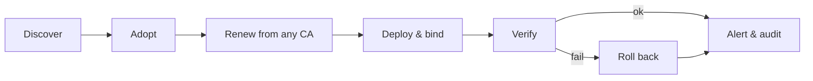

# AutomateCert

**Certificate lifecycle automation for Windows estates — every certificate, every server, every CA, one console.**

AutomateCert discovers TLS certificates on Windows servers and network endpoints and renews them from any certificate authority (Let's Encrypt, DigiCert, Sectigo, GlobalSign, ZeroSSL, Google Trust Services, private ACME, Microsoft AD CS). It deploys them to IIS, AD FS, WAP, Exchange, RD Gateway, RDP, SQL Server and Dynamics CRM, verifies every step, rolls back on failure, and alerts and audits everything.

Public TLS certificate lifetimes fall to 100 days in March 2027 and 47 days in March 2029 (CA/Browser Forum ballot SC-081). Manual renewal stops scaling; AutomateCert makes renewal a non-event.



## Features
| Area | What you get |
|---|---|
| Discovery | Agent inventory of every certificate and its bindings; agentless TLS endpoint monitoring; network discovery (CIDR); Certificate Transparency monitoring |
| Issuance | ACME (RFC 8555) with External Account Binding; DNS-01 via Cloudflare, Azure DNS, Route 53, GoDaddy, RFC 2136/TSIG, Windows DNS, webhook, CNAME delegation or manual; Microsoft AD CS via `certreq` |
| Deployment | IIS, AD FS (SSL + staged token-signing), WAP, Exchange, RD Gateway, RDP, SQL Server, Dynamics CRM claims, "replace everywhere" adoption, TLS verification and automatic rollback |
| Governance | Roles (Admin, Operator, Approver, Viewer), approvals with separation of duties, two-step sign-in (TOTP, e-mail, recovery codes), audit trail, compliance checks, security score |
| Operations | Expiry alerts (e-mail, Teams/Slack webhook), weekly summary, CSV reports, CA account balances, subscription-end alerts |
| AI (optional) | Bring your own model (Azure OpenAI, OpenAI, Ollama…): Copilot over live data, failure diagnosis, Autopilot recommendations. Read-only; actions are proposals a user must click |
| Installers | Server setup wizard (optional SQL Server Express, certificate, database, admin, firewall, local agent) and an agent installer with silent mode for GPO/SCCM/Intune |

## Repository layout
```
src/AutomateCert.Shared   Contracts shared by server and agent (deployment-template allow-list, wire records)
src/AutomateCert.Server   Console + REST API (ASP.NET Core, EF Core/SQL Server), scheduler, ACME, alerts, AI, UI (wwwroot)
src/AutomateCert.Agent    Windows service on managed servers; embedded PowerShell deployment scripts (Scripts/)
deploy/                   Build, install, upgrade, verification and secret-scan scripts; SQL scripts
installer/                Inno Setup wizards for server and agent
docs/                     Architecture, installation, user/admin guides, providers, CRM & AD FS, security, test plan
.github/                  CI workflow and templates
```

## Requirements
| For | Requirement |
|---|---|
| Development | Windows 10/11 or Windows Server, .NET 10 SDK, Visual Studio 2026 (or `dotnet` CLI), SQL Server (Developer or Express), PowerShell 5.1 |
| Installers | Inno Setup 6 (`winget install --id JRSoftware.InnoSetup -e`) |
| Production | Windows Server 2016–2025 x64, SQL Server 2016+ (or Express). No IIS or .NET runtime needed (self-contained) |

## Quick start (development)
```powershell
git clone <repository-url>
cd <repository-folder>
dotnet dev-certs https --trust
```
1. Open `AutomateCert.sln`, set **AutomateCert.Server** as start-up project and run it (Ctrl+F5 is much faster than F5 with the debugger).
2. Browse to `https://localhost:7443`. The database `AutomateCert_Dev` on the local SQL Server (`.`) is created automatically; change the connection string in `src/AutomateCert.Server/appsettings.Development.json` if needed.
3. Create the first organisation and administrator on the setup screen.
4. To manage the same machine: `powershell -ExecutionPolicy Bypass -File .\deploy\build.ps1`, then **Servers → Connect servers** and run the command in an elevated PowerShell.

### Optional: e-mail alerts in development
SMTP is empty by default. Store your settings in user secrets — never in `appsettings.json`:
```powershell
dotnet user-secrets set "Smtp:Host"              "<smtp host>"     --project src\AutomateCert.Server
dotnet user-secrets set "Smtp:FromAddress"       "<from address>"  --project src\AutomateCert.Server
dotnet user-secrets set "Smtp:UseAuthentication" "true"            --project src\AutomateCert.Server
dotnet user-secrets set "Smtp:Username"          "<user>"          --project src\AutomateCert.Server
dotnet user-secrets set "Smtp:Password"          "<password>"      --project src\AutomateCert.Server
```

## Build and package
```powershell
powershell -ExecutionPolicy Bypass -File .\deploy\verify-build.ps1         # build + error summary
powershell -ExecutionPolicy Bypass -File .\deploy\check-secrets.ps1        # run before every push
powershell -ExecutionPolicy Bypass -File .\deploy\build.ps1                # artifacts\ (zip packages)
powershell -ExecutionPolicy Bypass -File .\installer\build-installers.ps1  # dist\ Setup.exe files
```
The installer publisher name and URL are build-time defines (`ISCC /DAppPublisher="..." /DAppPublisherURL="..."`). Set `AUTOMATECERT_SIGN_THUMBPRINT` to sign binaries and installers with your code-signing certificate.

## Configuration and secrets
- `appsettings.json` contains **defaults only**: no host names, e-mail addresses or credentials.
- Development: `dotnet user-secrets`. Production: the installer writes `appsettings.Production.json` (ACL-protected, git-ignored), or use environment variables such as `Smtp__Password`.
- CA, DNS, CA-account and AI credentials are entered in the console and stored encrypted (ASP.NET Data Protection; key ring protected by machine DPAPI).
- `.gitignore` blocks `appsettings.Production.json`, `App_Data/`, key rings, `.pfx`/`.key`/`.pem` files, installer answer files and logs.

## Documentation
| Document | Contents |
|---|---|
| [docs/ARCHITECTURE.md](docs/ARCHITECTURE.md) | Components, data model, job state machine, sequences, extension points |
| [docs/SETUP-AND-TEST.md](docs/SETUP-AND-TEST.md) | Development environment and full test plan |
| [docs/PRODUCTION-INSTALL.md](docs/PRODUCTION-INSTALL.md) | Setup wizard, unattended install, upgrade, backup, uninstall |
| [docs/USER-GUIDE.md](docs/USER-GUIDE.md), [docs/ADMIN-GUIDE.md](docs/ADMIN-GUIDE.md) | Screens, roles, workflows, alerts |
| [docs/PROVIDERS.md](docs/PROVIDERS.md) | Certificate authorities, CA accounts, DNS providers |
| [docs/CRM-ADFS.md](docs/CRM-ADFS.md) | AD FS, WAP and Dynamics CRM automation and runbooks |
| [docs/SECURITY.md](docs/SECURITY.md) | Threat model, controls, hardening checklist |
| [CHANGELOG.md](CHANGELOG.md) | Release history |

## Known limitations
- AD FS farms: one agent and profile per node (no key distribution yet).
- F5, NetScaler and Linux endpoints are monitored, not renewed.
- Single server instance (no distributed job locking); no Entra ID single sign-on for the console yet.
- The Sectigo account connector supports Sectigo Certificate Manager (SCM) only, not the partner/reseller API.

## Disclaimer
AutomateCert changes live server configuration. Test with a staging certificate authority first, keep approvals on for production identity systems, and accept each CA's subscriber agreement. AI output can be wrong; verify before acting.

## Licence
See [LICENSE](LICENSE). Third-party components: [THIRD-PARTY-NOTICES.txt](THIRD-PARTY-NOTICES.txt).
