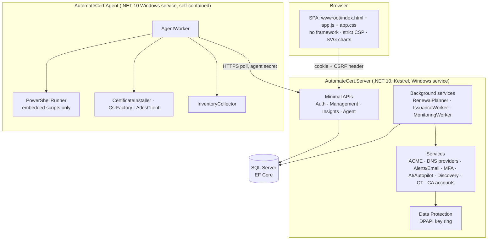
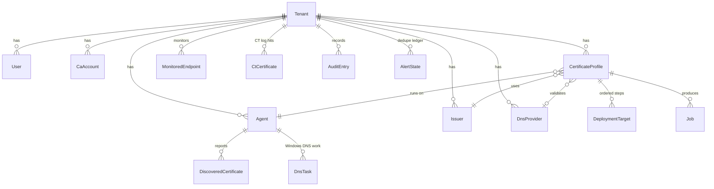
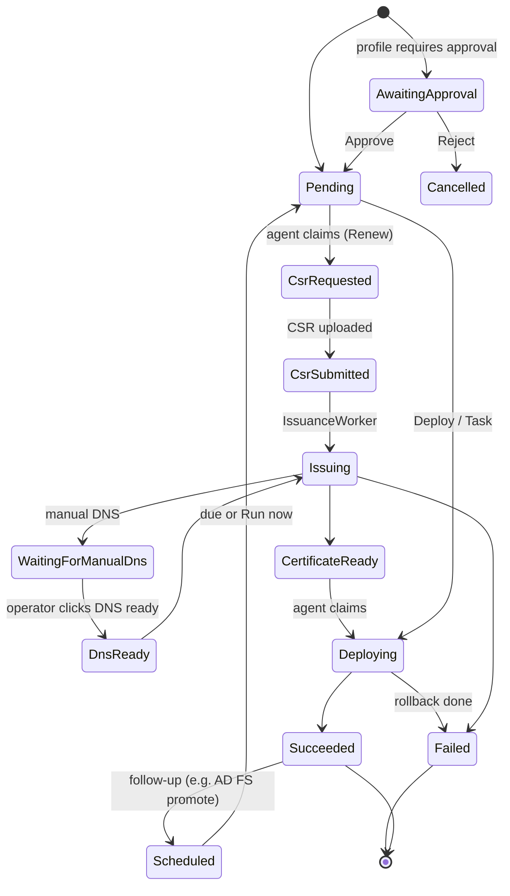
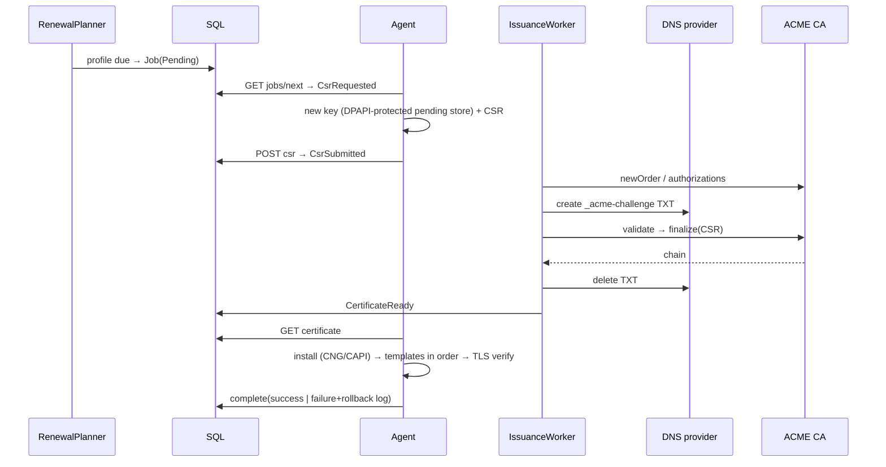

# Architecture (developer guide)

## 1. Components


| Project | Purpose |
|---|---|
| `AutomateCert.Shared` | Wire contracts (`AgentJob`, `InventoryReport`…), job types and statuses, the **allow-list of deployment templates** with typed parameters and validation shared by server and agent |
| `AutomateCert.Server` | Console and API, scheduler, ACME issuance, DNS automation, alerting, AI, discovery, reporting, installer bootstrap (`--init`) |
| `AutomateCert.Agent` | Key and CSR generation, AD CS enrollment, installation, deployment templates, verification, rollback, inventory, Windows DNS tasks |

## 2. Data model (core)

Every tenant-owned entity has a global query filter (`TenantId == CurrentTenantId`) and a save-time guard. The schema is created by `EnsureCreated`, then upgraded in place by `SchemaUpgrader`. All statements are idempotent and the same SQL ships as `deploy/server/upgrade-schema.sql`.

## 3. Job state machine

Back-off after failures: 30 min, doubling up to 24 h. Jobs with no progress for 3 hours time out.

## 4. Renewal sequence (ACME)

AD CS issuers skip the server leg: the agent submits the CSR with `certreq` as the computer account.

## 5. Agent template contract
Each template is an embedded `Scripts/<key>.ps1`, re-extracted on every run (so a tampered copy on disk is never used). It is called as `powershell -File <script> -ParamFile <json>`; the parameters are never placed on the command line. The script must print one line:
```
##AUTOMATECERT##{"ok":true,"previousThumbprint":"…","message":"…"}
```
`previousThumbprint` drives rollback: the engine re-runs the same template with the previous thumbprint. Parameters are validated against `DeploymentTemplates` on both the server and the agent.

**Adding a template:**
1. Add the definition in `Contracts.cs` (key, category, parameters, flags).
2. Add `Scripts/<key>.ps1`.
3. Add a rule in `RuleDiagnostics` for its common failure messages.
4. Document it.

## 6. AI design
- **Bring your own model**: Azure OpenAI v1, OpenAI, or any OpenAI-compatible endpoint (Ollama, vLLM).
- Copilot gets **read-only, tenant-scoped tools** (overview, certificates, endpoints, profiles, jobs, agents). Tool output is redacted for secrets.
- **Agentic, with a person in the loop:** the model and Autopilot return *proposed actions*. The UI shows them as buttons, and the normal API runs them with the clicking user's role, so RBAC and approvals still apply.
- `RuleDiagnostics` works without any model.

## 7. Background schedule
| Worker | Interval | Work |
|---|---|---|
| RenewalPlanner | 5 min | Due profiles, scheduled follow-ups, time-outs, AlertEngine (expiry, offline, approvals, coverage, balance, weekly summary) |
| IssuanceWorker | 10 s | ACME orders for submitted CSRs or confirmed DNS |
| MonitoringWorker | 1 min loop | Endpoint rescans (every 6 h), CT log sync (every 12 h), CA account sync (every 6 h) |

## 8. Build and release
`deploy/build.ps1` → `artifacts/` (self-contained server, single-file agent, zips). `installer/build-installers.ps1` → `dist/` (Inno Setup). The version comes from `Directory.Build.props`, and `AgentProtocol.Version` must match it.

## 9. Coding conventions
- No inline script or style anywhere in the UI, so the CSP stays strict. Charts are SVG built with DOM APIs and CSS classes.
- Every state-changing endpoint records an `AuditEntry`.
- Secrets go through `SecretProtector` and are never returned to the UI.
- Prefer allow-lists and regex validation for anything that reaches PowerShell.
