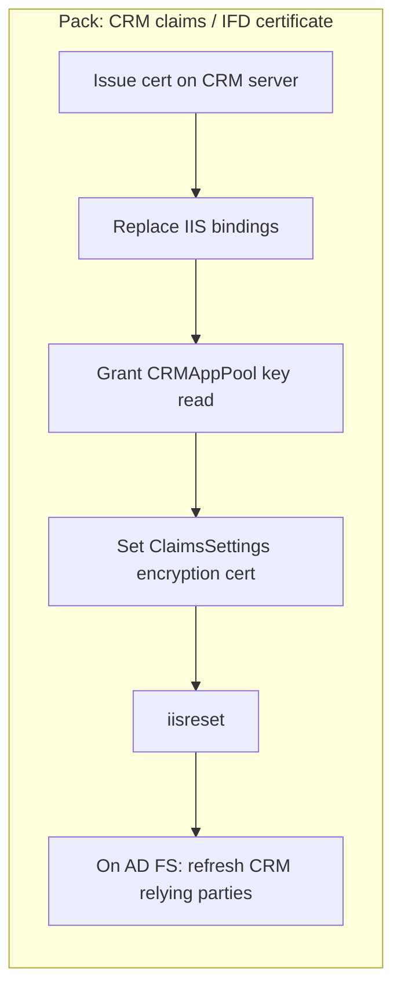
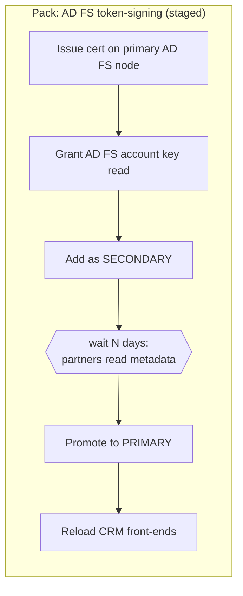

# CRM & AD FS — automation and runbooks

> **Disclaimer.** These steps change live AD FS, WAP and Dynamics CRM configuration and can interrupt sign-in. Test in a non-production environment first, export the AD FS configuration and back up the CRM configuration database, run inside an approved maintenance window, and keep approval enabled. AutomateCert automates documented Microsoft procedures; your change-control process stays in charge.

## 1. Which certificates are involved
| Certificate | Where it lives | Who renews it | AutomateCert template |
|---|---|---|---|
| AD FS SSL + service communications | Every AD FS node | Your CA | `adfs` (or `rebind` after adoption) |
| WAP SSL + published applications | Every WAP node | Your CA | `wap` |
| AD FS token-signing / token-decrypting | AD FS configuration (farm-wide) | AD FS itself when AutoCertificateRollover is on (default); otherwise you | `adfstoken` (staged) |
| CRM website (IIS) | Every CRM front-end | Your CA | `iis` / `rebind` |
| CRM claims encryption | CRM deployment (ClaimsSettings) | Your CA (often the same wildcard) | `crmclaims` |
| AD FS relying-party data for CRM | AD FS | Refreshed from CRM metadata | `adfsrprefresh` |

**Recommendation:** keep AutoCertificateRollover on, so AD FS manages its own token certificates, and let AutomateCert handle SSL and the CRM certificates. Use `adfstoken` only when policy requires CA-issued token certificates.

## 2. The CRM & AD FS page
- Detects AD FS, WAP and CRM servers from agent inventory and shows their bound certificates and expiry.
- Shows whether AD FS AutoCertificateRollover is on.
- **Guided packs** create correctly ordered automation profiles with approval switched on:

The promote step is a **Scheduled** job. **Run now** in Jobs starts it early; **Cancel** stops it.

## 3. What each template does
### `adfstoken`
1. Requires AutoCertificateRollover to be off. It refuses to run otherwise, unless you explicitly allow it to switch the setting off.
2. Grants the AD FS service account read access to the new private key.
3. Runs `Add-AdfsCertificate -CertificateType Token-Signing|Token-Decrypting -Thumbprint <new>` (secondary).
4. In the promote phase, runs `Set-AdfsCertificate -CertificateType … -Thumbprint <new> -IsPrimary`. The previous primary stays as secondary until it expires.
5. **Rollback** sets the previous certificate back to primary.

### `crmclaims`
1. Finds the CRMAppPool identity (specific user, NetworkService or ApplicationPoolIdentity) and grants it read access to the new key. CRM fails with *ID1039 … private key could not be accessed* without this.
2. `Get-CrmSetting -SettingType ClaimsSettings` → sets `EncryptionCertificate` to the new certificate's subject → `Set-CrmSetting`. This is skipped if the subject is unchanged. The agent's computer account must be a CRM Deployment Administrator, or switch this step off and set it once in Deployment Manager.
3. Warns if older certificates with the same subject remain in the store, because CRM selects by subject. Remove them after sign-in is verified.
4. `iisreset /noforce` unless switched off.

### `adfsrprefresh`
Runs `Update-AdfsRelyingPartyTrust -TargetName <name>` for the named relying parties, so AD FS reads CRM's new encryption certificate from CRM's federation metadata.

## 4. Manual steps that remain, and why
| Step | Why it is manual |
|---|---|
| Microsoft 365 / Entra ID federated domains after a token-signing change (if not updated automatically) | Needs Entra admin rights in the cloud tenant |
| SaaS relying parties without a metadata URL | The partner must upload your new public certificate |
| AD FS farm secondary nodes (SSL) | One agent and profile per node today; key distribution is on the roadmap |
| CRM IFD reconfiguration | Only needed when host names change, not for renewals |

## 5. Runbook: AD FS + CRM renewal window (example)
1. Day −14: AutomateCert issues the new SSL/wildcard certificate (approval required).
2. Day −14: Approver releases it. AD FS and WAP nodes are updated one by one and verified.
3. Day −14: CRM pack: bindings → claims encryption → iisreset → relying-party refresh on AD FS.
4. Test internal and external (IFD) CRM sign-in.
5. Day −7: remove superseded certificates from CRM front-ends.
6. If token-signing is CA-managed: stage the new certificate as secondary and promote it after partners have read the metadata.
