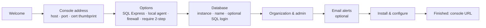

# Production installation (1.5)

## 1. Requirements
| Item | Requirement |
|---|---|
| Server | Windows Server 2016/2019/2022/2025 x64, 2 vCPU, 4 GB RAM, 2 GB disk |
| Database | SQL Server 2016+ (local or remote). **Or let Setup install SQL Server 2022 Express** (internet required) |
| Account running Setup | Local administrator, and SQL `sysadmin` on an existing SQL Server |
| DNS | A name for the console, e.g. `automatecert.contoso.com` |
| Certificate | Optional. If none exists for that name, Setup creates a self-signed one; agents pin it, and AutomateCert can later renew it with a CA |
| Port | 443 by default, and it must be free. If IIS already uses 443 on this server, choose e.g. 8443 |
| Outbound network | CA ACME URLs, DNS provider APIs, SMTP relay, crt.sh (CT monitoring), CA APIs (balances), monitored endpoints |

Nothing else is needed: no IIS and no .NET runtime. The server is self-contained.

## 2. The setup wizard
Run `AutomateCertServer-Setup-1.5.0.exe` as administrator.



What Setup does after you click **Install**:
1. Checks that the HTTPS port is free.
2. Installs SQL Server 2022 Express if you chose that option and no SQL Server is reachable.
3. Copies the application to `C:\Program Files\AutomateCert\Server`.
4. Creates the **AutomateCertServer** service under the virtual account `NT SERVICE\AutomateCertServer`.
5. Finds or creates the HTTPS certificate and grants the service read access to its key.
6. Creates the database and a least-privilege login (read/write only).
7. Writes `appsettings.Production.json`, readable only by SYSTEM, Administrators and the service.
8. Creates the schema, the organisation and the first administrator, and adds **Let's Encrypt (production and staging)** and a Manual DNS provider.
9. Opens the firewall, starts the service and checks `/healthz`.
10. Installs and enrolls the **agent on the console server**, so it can manage its own certificate and local services.

Log: `C:\ProgramData\AutomateCert\Server\install-<timestamp>.log`.

## 3. Unattended or scripted install
From `AutomateCert-Server-1.5.0.zip`:
```powershell
.\Install-Server.cmd -PublicHostName automatecert.contoso.com -InstallSqlExpress -OrganizationName "Contoso" `
  -AdminEmail admin@contoso.com -AdminPassword 'Use-A-Strong-One-123' -OpenFirewall `
  -SmtpHost smtp.contoso.com -SmtpFrom automatecert@contoso.com -SmtpUser automatecert@contoso.com -SmtpPassword '...'
```
Other switches: `-SqlServer SQL01`, `-SqlAuth Sql -SqlUser -SqlPassword`, `-HttpsPort 8443`, `-CertificateThumbprint`, `-RequireMfa`, `-AlertEmails`, `-InstallLocalAgent $false`, `-SqlExpressInstaller <path>` (offline media). Passwords are passed through a temporary answer file or parameters and never written to logs.

## 4. After installation (about 15 minutes)
1. Sign in and turn on two-step verification (**Settings → My account**). Consider **Require two-step verification** for everyone.
2. **Settings → Alerts:** recipients → **Send test email**. If you see *"authorised users only"*, the relay needs SMTP authentication or your server's IP allowed.
3. **CAs & DNS:** add commercial CAs (EAB credentials), CA accounts (DigiCert API key, Sectigo SCM login) and DNS providers. See [PROVIDERS.md](PROVIDERS.md).
4. **Servers → Connect servers → Many servers:** push `AutomateCertAgent-Setup.exe` silently by GPO, SCCM or Intune.
5. **Certificates → Manual only → Adopt** the important certificates (zero-downtime).
6. **CRM & AD FS:** set up the guided packs if relevant ([CRM-ADFS.md](CRM-ADFS.md)).
7. **Console certificate:** create an automation for the console host name on the console server's own agent, with the target *AutomateCert console itself*.

## 5. Upgrade
Run the newer Setup. It detects the installation, skips the pages, and keeps configuration, keys and data. The schema is upgraded automatically. Alternatively run `Install-Server.cmd -Upgrade`. Upgrade agents by running the new `AutomateCertAgent-Setup.exe` (silently is fine); enrollment is kept.

## 6. Backup and disaster recovery
Back up together:
- the SQL database;
- `C:\ProgramData\AutomateCert\Server\keys` (encrypts CA, DNS, AI and TOTP secrets);
- `appsettings.Production.json`.

The key ring is protected with machine DPAPI. On a different server, re-enter the CA, DNS and AI credentials, or configure certificate-based key protection (see [SECURITY.md](SECURITY.md)).

## 7. Uninstall
Use *Apps & features*, or `Uninstall-AutomateCertServer.ps1`. Configuration is backed up; the database, keys and certificates are kept. `-RemoveData` also deletes ProgramData.

## 8. Code signing before distribution
```powershell
signtool sign /fd SHA256 /tr http://timestamp.digicert.com /td SHA256 /a dist\*.exe
```
Also sign `AutomateCert.Server.exe`, `AutomateCert.Agent.exe` and all `.ps1` files in the build output. Signing avoids SmartScreen warnings and the PowerShell "not digitally signed" error.
