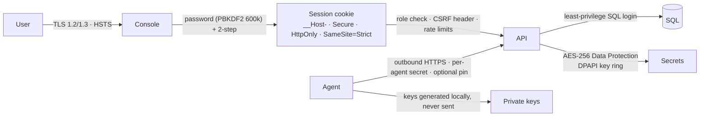

# Security design (1.5)

## 1. Controls at a glance

## 2. Threat model
| Threat | Control |
|---|---|
| Key theft from console or database | Private keys are generated on target servers and never transmitted; the console stores CSRs and public chains only |
| Stolen database backup | CA keys, EAB HMAC, DNS and CA-account credentials, AI keys and TOTP seeds are encrypted; the key ring lives outside the database (DPAPI) |
| Over-privileged service | Virtual account `NT SERVICE\AutomateCertServer`; SQL `db_datareader` + `db_datawriter`; schema changes only with the installer's rights; config ACL'd |
| Account takeover | 12+ character passwords with a common-word blocklist; PBKDF2-SHA256 600k; lockout after 5 failures; TOTP (RFC 6238, replay-protected), email OTP and recovery codes; org-wide 2-step enforcement; admin resets force a password change |
| Session abuse | Strict cookie flags; configurable session lifetime; principal revalidated on every request (disabled user or role change takes effect immediately) |
| CSRF, XSS, clickjacking | Custom-header CSRF check; strict CSP with no inline script or style; output escaping; `frame-ancestors 'none'`, X-Frame-Options DENY; COOP/CORP; no-referrer; Permissions-Policy |
| Downgrade | Kestrel restricted to TLS 1.2 and 1.3; HSTS |
| Rogue server instructs the agent | Agent runs only embedded scripts, with parameters validated on both sides and passed via a file; server-only parameters are stripped from user input |
| Agent impersonation | 256-bit per-agent secret (hash only at rest); single-use or bounded fleet tokens with expiry; revocation |
| Insider making unauthorised changes | RBAC (Admin, Operator, Approver, Viewer); approvals with separation of duties; reject; full audit trail with CSV export |
| AI misuse or prompt injection | Bring-your-own endpoint; read-only tools; secrets redacted; actions only proposed and run with the clicking user's role |
| Network scan misuse | Operator role only; size-limited CIDR; TLS handshake only; audited; disclaimer |

## 3. Security posture page
**Settings → Security** scores the live configuration: transport, CSP, 2-step enforcement, privileged users with 2-step, password policy, secrets at rest, session lifetime, SMTP authentication, AI data boundary, outstanding enrollment tokens, and sign-in failures in the last 24 hours.

## 4. Hardening checklist
- [ ] Replace the self-signed console certificate with a CA-issued one (or let AutomateCert manage it).
- [ ] **Require two-step verification** for every user; keep Admins few.
- [ ] Use Approver accounts for production change approval.
- [ ] Use authenticated SMTP; restrict `appsettings.Production.json` (Setup does this).
- [ ] Back up the keys folder with the database, separately and encrypted.
- [ ] For DR portability, protect the Data Protection key ring with a certificate instead of machine DPAPI.
- [ ] Scope DNS and CA API credentials to the minimum (zone-level, read-only CA keys).
- [ ] Sign binaries, scripts and installers with your code-signing certificate.
- [ ] Forward Windows Application logs (sources `AutomateCert.Server`, `AutomateCert.Agent`) to the SIEM.
- [ ] Not yet available, on the roadmap: Entra ID SSO and passkeys for console sign-in.
