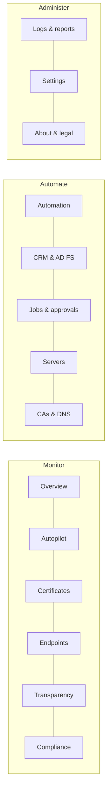
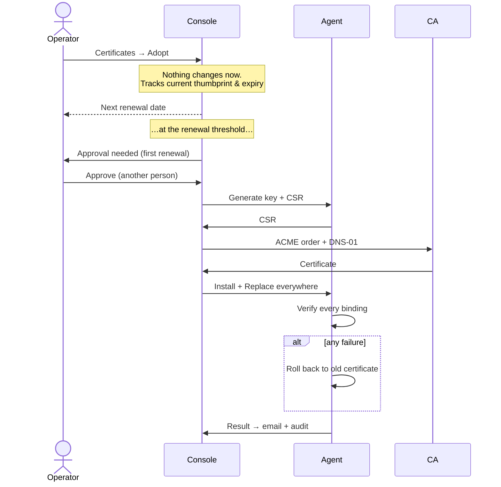

# AutomateCert user guide (1.5)

## 1. Signing in
1. Open the console URL, e.g. `https://automatecert.contoso.com`.
2. Enter your email and password.
3. If two-step verification is on, enter the 6-digit code from your authenticator app, the code that was emailed to you, or a recovery code (`ABCDE-FGHIJ`).
4. If an administrator reset your password, you are asked to choose a new one before anything else.
5. If your organisation requires two-step verification and you have not set it up, the setup screen appears first.

Accounts lock for 15 minutes after 5 wrong passwords or codes. Sessions end after the configured number of hours (Settings → Security).

## 2. The console at a glance

| Screen | Use it to |
|---|---|
| **Overview** | See the health grade, expiry forecast, CA vendors, automation coverage, renewal trend, AI briefing and next expiries |
| **Autopilot** | Work through prioritised risks; each has a one-click action (Adopt, Renew, Approve, Open…) |
| **Certificates** | Search and filter every server certificate by vendor, expiry or automation; **Adopt** to automate one |
| **Endpoints** | Monitor TLS on appliances, Linux and external sites; **Discover** scans a network range |
| **Transparency** | See certificates issued for your domains in public CT logs and acknowledge known ones |
| **Compliance** | Fix weak keys, SHA-1, over-long lifetimes, self-signed or untrusted certificates, name mismatches and legacy TLS |
| **Automation** | Create, edit, renew and delete automation profiles |
| **CRM & AD FS** | See the AD FS farm, WAP and CRM as one system; set up the guided packs |
| **Jobs & approvals** | Follow every renewal step; approve, reject, diagnose, run a scheduled step now |
| **Servers** | Connect servers (one or a fleet), run discovery, revoke |
| **CAs & DNS** | CAs, CA accounts (balance and status), DNS providers |
| **Logs & reports** | Audit trail, system events, CSV exports |
| **Settings** | Alerts, weekly summary, security, CT domains, AI assistant, users |
| **About & legal** | Version, licence notices, disclaimers |

Use the sun/moon button for light or dark mode. **✦ Ask Copilot** (bottom right) opens the AI assistant if it is enabled.

## 3. Roles
| Permission | Admin | Operator | Approver | Viewer |
|---|:-:|:-:|:-:|:-:|
| See dashboards, inventory, jobs, reports | ✔ | ✔ | ✔ | ✔ |
| Approve or reject changes | ✔ | ✔ | ✔ | |
| Create, adopt, edit and renew automations; endpoints; discovery | ✔ | ✔ | | |
| CAs, CA accounts, DNS providers, connect/revoke servers | ✔ | | | |
| Users, security, alerts and AI settings | ✔ | | | |

**Separation of duties:** the person who requested a change can never approve it. Use Approver for change-advisory boards and security teams.

### Managing users (Settings → Users)
- **Add user:** name, email, role and a temporary password. The user must change the password at first sign-in.
- **Change role:** pick a new role in the list. It takes effect on the user's next request.
- **Reset password:** sets a new temporary password and forces a change.
- **Reset 2-step:** use when someone loses their phone. They set it up again at next sign-in.
- **Disable / Enable:** a disabled user is signed out immediately.

## 4. Everyday workflows

### 4.1 Connect servers
**Servers → Connect servers →** choose **One server** or **Many servers**, then **Generate**.
- One server: download `AutomateCertAgent-Setup.exe` and paste the URL and token, or run the PowerShell one-liner as administrator.
- Many servers: deploy silently with GPO, SCCM or Intune:
  `AutomateCertAgent-Setup.exe /VERYSILENT /SUPPRESSMSGBOXES /SERVERURL="https://automatecert.contoso.com" /TOKEN="<token>"` (add `/PIN=1` for a self-signed console certificate).

### 4.2 Automate an existing certificate (adoption)

### 4.3 New certificate
**Automation → + New automation**: names, server, CA, DNS provider, key and threshold, then the deployment targets in order. **Renew now** issues immediately.
Public CAs cannot issue for internal names (`.local`, `.corp`, single-label names). AutomateCert warns you while you type; use AD CS for those.

### 4.4 Approvals
Jobs that need approval show in **Jobs & approvals** with a counter in the menu and an email. **Approve** releases the job; **Reject** cancels it. Both are recorded in the audit trail with who and when.

### 4.5 When something fails
Open the job and click **✦ Diagnose**. Built-in rules recognise common failures (internal names, CAA, EAB, DNS, rate limits, key permissions, AD CS, AD FS, CRM). If AI is enabled you also get a root-cause explanation. The previous certificate stays in place.

### 4.6 Reports and email
- **Logs & reports:** CSV exports for certificates, endpoints and the audit trail.
- **Settings → Alerts:** recipients, expiry thresholds (default 30/14/7/3/1 days), success emails, Teams/Slack webhook, and the **weekly executive summary** (Mondays). Use **Send test email** and **Send summary now** to check delivery.

## 5. Disclaimers you will see
| Where | Meaning |
|---|---|
| Sign-in page | Authorised use only; activity is logged |
| Copilot / Autopilot | AI can be wrong; it only proposes; verify before confirming |
| CRM & AD FS | Changes affect live sign-in; test first, back up, use a maintenance window, keep approvals on |
| CAs & DNS | Certificates are issued under each CA's own terms; balance figures come from the CA and may be delayed |
| Endpoint discovery | Scan only networks you own or are authorised to test |
